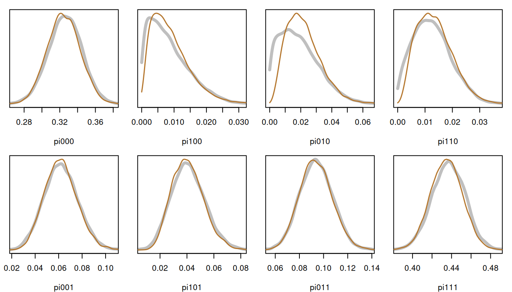

# Diagnostic classification models

A diagnostic classification model (DCM) sorts examinees by which of a
few skills, or *attributes*, they have mastered. Each examinee belongs
to one of \\2^K\\ latent classes, one for each pattern of mastery of
\\K\\ attributes. The latent variable is discrete, so it sums out of the
likelihood exactly: the log-posterior of the item parameters and the
class proportions has a closed form, and
[`inla_vanilla()`](http://haziqj.ml/inlavanilla/reference/inla_vanilla.md)
can take it as it is.

This article fits the DINA model to a language test, and compares the
posterior marginals with those of Stan.

``` r

library(inlavanilla)
data(items_ecpe, qmatrix_ecpe, package = "edmdata")
```

## The data

The Examination for the Certificate of Proficiency in English (ECPE)
data (Templin & Hoffman, 2013), from the edmdata package, hold the right
or wrong answers of 2,922 examinees to 28 grammar items. A Q-matrix
records which of three attributes each item requires: morphosyntactic,
cohesive and lexical rules.

``` r

y <- unclass(items_ecpe)
q <- unclass(qmatrix_ecpe)
dim(y)
#> [1] 2922   28
head(q)
#>        Trait1 Trait2 Trait3
#> Item01      1      1      0
#> Item02      0      1      0
#> Item03      1      0      1
#> Item04      0      0      1
#> Item05      0      0      1
#> Item06      0      0      1
```

## The model

The \\2^3 = 8\\ classes are the rows of `alpha`, from no attribute
mastered (`000`) to all three (`111`). In the DINA model (“deterministic
input, noisy and gate”), examinee \\i\\ in class \\c\\ answers item
\\j\\ correctly with probability \\1 - s_j\\ if the class has every
attribute the item requires (\\\eta\_{jc} = 1\\), and with probability
\\g_j\\ otherwise:

\\ P(y\_{ij} = 1 \mid c) = (1 - s_j)^{\eta\_{jc}} \\ g_j^{1 -
\eta\_{jc}}, \qquad p(y_i) = \sum\_{c=1}^{8} \pi_c \prod\_{j=1}^{28}
P(y\_{ij} = 1 \mid c)^{y\_{ij}} \\1 - P(y\_{ij} = 1 \mid c)\\^{1 -
y\_{ij}}. \\

The *guessing* and *slipping* probabilities \\g_j\\ and \\s_j\\ get
uniform priors, and the class proportions \\\pi\\ a Dirichlet(1) prior.

``` r

alpha <- as.matrix(expand.grid(rep(list(0:1), ncol(q))))
colnames(alpha) <- c("morphosyntactic", "cohesive", "lexical")
classes <- apply(alpha, 1, paste, collapse = "")
eta <- (alpha %*% t(q)) == matrix(rowSums(q), 8, 28, byrow = TRUE)
```

## The log-posterior

The probabilities go on the logit scale, and the class proportions on
the log-ratio scale against class `000`. Under a uniform prior the
log-density of \\\text{logit}(g)\\ is the log-Jacobian, \\\log g +
\log(1 - g)\\. Under a Dirichlet(1) prior the log-density of the
log-ratios is \\\sum_c \log \pi_c\\.

``` r

logpost <- function(theta, y, eta) {
  g <- plogis(theta[1:28])
  s <- plogis(theta[29:56])
  log_pi <- c(0, theta[57:63])
  log_pi <- log_pi - log(sum(exp(log_pi)))

  # Probability of a correct answer, items by classes
  p <- t(eta) * (1 - s) + t(!eta) * g

  # Log-likelihood of each examinee in each class, then summed over classes
  l <- y %*% log(p / (1 - p)) +
    rep(colSums(log1p(-p)) + log_pi, each = nrow(y))
  l_max <- l[cbind(seq_len(nrow(l)), max.col(l))]
  loglik <- sum(l_max + log(rowSums(exp(l - l_max))))

  loglik + sum(log(g) + log1p(-g) + log(s) + log1p(-s)) + sum(log_pi)
}
```

## The fit

There are 63 parameters: 28 guessing and 28 slipping parameters, and 7
class log-ratios.

``` r

init <- c(
  setNames(rep(qlogis(0.2), 28), sprintf("g%02d", 1:28)),
  setNames(rep(qlogis(0.1), 28), sprintf("s%02d", 1:28)),
  setNames(rep(0, 7), paste0("pi", classes[-1]))
)
fit <- inla_vanilla(logpost, init, y = y, eta = eta)
#> ✔ Found the posterior mode in 186 iterations [36.2s]
#> ✔ VB mean correction, max shift 0.44σ [1m 4s]
#> ✔ Fitted 63 skew-normal marginals [27.6s]
```

Draws give the parameters on the probability scale, and the share of
examinees who have mastered each attribute, \\\sum_c \pi_c
\alpha\_{ck}\\:

``` r

natural <- function(theta) {
  log_pi <- c(0, theta[57:63])
  pi <- exp(log_pi) / sum(exp(log_pi))
  c(
    plogis(theta[1:56]),
    setNames(pi, paste0("pi", classes)),
    colSums(pi * alpha)
  )
}
set.seed(1)
draws <- sampling(fit, nsamp = 10000, fun = natural)
round(colMeans(draws[, 57:67]), 3)
#>           pi000           pi100           pi010           pi110 
#>           0.324           0.009           0.022           0.014 
#>           pi001           pi101           pi011           pi111 
#>           0.062           0.041           0.094           0.435 
#> morphosyntactic        cohesive         lexical 
#>           0.498           0.564           0.631
```

Over two in five examinees have mastered all three attributes, and
nearly a third none of them. The classes with only the morphosyntactic
or only the cohesive attribute are rare, at 1 to 2%.

The fit takes about 40 seconds, most of it in the 70,000 or so calls of
`logpost` that 63 parameters need without a gradient.

## Checking against Stan

Stan samples the same model, with the classes summed out in the same way
and the same priors. Its 10,000 draws took about two minutes, after
compiling the model, and were summarised ahead of time
(`lab/dcm-article.R` in the package source), so this page does not need
Stan to build.

``` r

ref <- readRDS("dcm-stan.rds")
ref[c("rhat", "divergences")]
#> $rhat
#> [1] 1.001751
#> 
#> $divergences
#> [1] 0
```

For each block of parameters, the largest gap between the posterior
means, in Stan’s posterior SDs, and the range of the ratio of the SDs:

``` r

gap <- (colMeans(draws[, 1:64]) - ref$summary$mean) / ref$summary$sd
sd_ratio <- apply(draws[, 1:64], 2, sd) / ref$summary$sd
block <- rep(c("guessing", "slipping", "class proportions"), c(28, 28, 8))
data.frame(
  max_gap = tapply(abs(gap), block, max),
  sd_ratio_min = tapply(sd_ratio, block, min),
  sd_ratio_max = tapply(sd_ratio, block, max)
)[c("guessing", "slipping", "class proportions"), ] |>
  round(2)
#>                   max_gap sd_ratio_min sd_ratio_max
#> guessing             0.03         0.98         1.03
#> slipping             0.04         0.97         1.02
#> class proportions    0.23         0.87         0.99
```

The 56 item parameters agree to a few hundredths of a standard
deviation. The class proportions agree less closely where the classes
are rare. Their posteriors pile up against zero, which a skew-normal on
the log-ratio scale does not reach. The worst is `pi010`, the
cohesive-only class: its mean is 0.23 SD high and its SD 13% narrow, a
gap of 0.003 on the probability scale. `summary(fit)` flags it, and the
other two rare classes, with large ridge bends. The class proportions,
Stan in grey:

``` r

op <- par(mfrow = c(2, 4), mar = c(4, 1, 1, 1))
for (cl in paste0("pi", classes)) {
  d_ref <- ref$density[[cl]]
  d_iv <- density(draws[, cl], n = 256, from = 0)
  plot(
    d_ref$x, d_ref$y, type = "l", lwd = 4, col = "grey75",
    xlim = range(d_ref$x[d_ref$y > max(d_ref$y) / 100]),
    ylim = c(0, max(d_ref$y, d_iv$y)), xlab = cl, ylab = "", yaxt = "n"
  )
  lines(d_iv, lwd = 1.5, col = "#B5772E")
}
```



``` r

par(op)
```

## Classifying examinees

Each examinee’s chance of having mastered each attribute is a function
of the parameters, so draws of it average over their uncertainty. For
the first three examinees:

``` r

mastery <- function(theta, y_i) {
  g <- plogis(theta[1:28])
  s <- plogis(theta[29:56])
  log_pi <- c(0, theta[57:63])
  p <- t(eta) * (1 - s) + t(!eta) * g
  l <- drop(y_i %*% log(p / (1 - p))) + colSums(log1p(-p)) + log_pi
  w <- exp(l - max(l)) / sum(exp(l - max(l)))
  colSums(w * alpha)
}
set.seed(1)
t(sapply(1:3, function(i) {
  colMeans(sampling(fit, nsamp = 1000, fun = mastery, y_i = y[i, ]))
})) |>
  round(3)
#>      morphosyntactic cohesive lexical
#> [1,]           1.000    0.938       1
#> [2,]           1.000    0.804       1
#> [3,]           0.999    0.985       1
```

## References

Templin, J., & Hoffman, L. (2013). Obtaining diagnostic classification
model estimates using Mplus. *Educational Measurement: Issues and
Practice*, *32*(2), 37–50. <https://doi.org/10.1111/emip.12010>
