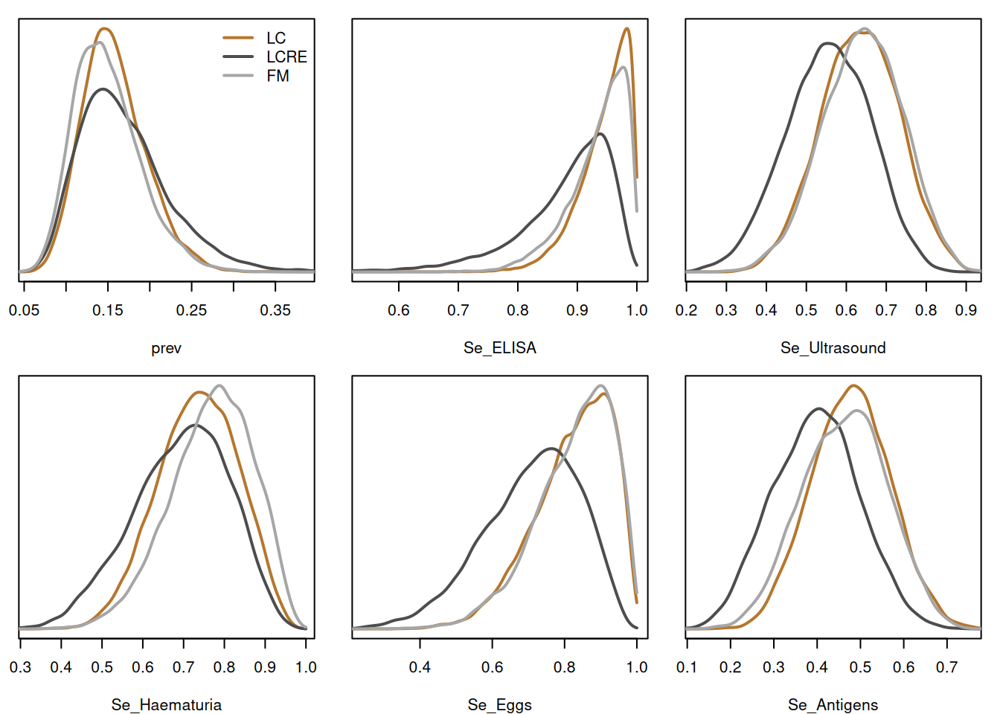

# Diagnostic tests without a gold standard

How accurate is a diagnostic test when no test is a gold standard? If
every person takes several imperfect tests, their true infection status
can be treated as a latent class, and the prevalence and each test’s
sensitivity and specificity estimated from the pattern of results.
Koukounari et al. (2021) compared three such latent class models for
tests of schistosomiasis, fitted in JAGS. This article fits all three to
one of their data sets with
[`inla_vanilla()`](http://haziqj.ml/inlavanilla/reference/inla_vanilla.md).
The infection status sums out of the likelihood, so each model has a
dozen or so parameters, and the fits take between a twentieth of a
second and two seconds.

``` r

library(inlavanilla)
```

## The data

Koukounari et al. (2009) tested 220 adults in three villages northwest
of Accra, Ghana, for *Schistosoma haematobium* infection with five
tests: an antibody ELISA, an ultrasound scan of the urinary tract, a
dipstick for blood in the urine, microscopy for eggs in the urine, and a
test for circulating antigens. Table 2 of Koukounari et al. (2021) gives
the counts of the 25 patterns of results that occurred, out of \\2^5 =
32\\ possible:

``` r

# 1 is a positive result, in the order of `tests`
patterns <- c(
  "00000" = 28, "00001" = 19, "00010" = 1, "00100" = 4, "00101" = 3,
  "00110" = 1, "01000" = 10, "01001" = 2, "01100" = 1, "10000" = 34,
  "10001" = 35, "10010" = 2, "10011" = 3, "10100" = 6, "10101" = 7,
  "10110" = 5, "10111" = 2, "11000" = 19, "11001" = 14, "11010" = 2,
  "11011" = 3, "11100" = 3, "11101" = 1, "11110" = 7, "11111" = 8
)
tests <- c("ELISA", "Ultrasound", "Haematuria", "Eggs", "Antigens")
y <- do.call(rbind, lapply(strsplit(names(patterns), ""), as.integer))
colnames(y) <- tests
count <- unname(patterns)
sum(count)
#> [1] 220
round(colSums(y * count) / sum(count), 2) # share positive on each test
#>      ELISA Ultrasound Haematuria       Eggs   Antigens 
#>       0.69       0.32       0.22       0.15       0.44
```

## Three models

Person \\i\\ is infected (\\D_i = 1\\) with probability \\\tau\\, the
prevalence. Test \\j\\ has sensitivity \\\text{Se}\_j = P(y\_{ij} = 1
\mid D_i = 1)\\ and specificity \\\text{Sp}\_j = P(y\_{ij} = 0 \mid D_i
= 0)\\. The three models differ in how the tests depend on each other.

**Conditional independence (LC).** Given the infection status, the tests
are independent:

\\ p(y_i) = \tau \prod\_{j=1}^5 \text{Se}\_j^{y\_{ij}} (1 -
\text{Se}\_j)^{1 - y\_{ij}} + (1 - \tau) \prod\_{j=1}^5 (1 -
\text{Sp}\_j)^{y\_{ij}} \text{Sp}\_j^{1 - y\_{ij}}. \\

**Random effects (LCRE).** A person-level random effect \\u_i \sim N(0,
1)\\, shared by the five tests, makes them depend on each other beyond
the infection status (Qu et al., 1996):

\\ P(y\_{ij} = 1 \mid D_i = d, u_i) = \Phi(\beta\_{jd} + \sigma_d u_i),
\qquad p(y_i) = \sum\_{d=0}^1 P(D_i = d) \int \prod\_{j=1}^5 P(y\_{ij}
\mid D_i = d, u)\\ \phi(u)\\ du. \\

Averaged over \\u\\, the sensitivities and specificities are

\\ \text{Se}\_j = \Phi\Bigl(\beta\_{j1} \big/ \sqrt{1 +
\sigma_1^2}\Bigr), \qquad \text{Sp}\_j = 1 - \Phi\Bigl(\beta\_{j0} \big/
\sqrt{1 + \sigma_0^2}\Bigr). \\

**Finite mixture (FM).** Some infected people test positive on every
test, and some uninfected people negative on every test, with
probabilities \\\eta_1\\ and \\\eta_0\\. Everyone else follows the
conditionally independent model, with probabilities \\w\_{j1}\\ of a
positive result if infected and \\w\_{j0}\\ of a negative one if not
(Albert & Dodd, 2004):

\\ p(y_i) = \tau \Bigl\\\eta_1 \[y_i = 11111\] + (1 - \eta_1) \prod_j
w\_{j1}^{y\_{ij}} (1 - w\_{j1})^{1 - y\_{ij}}\Bigr\\ + (1 - \tau)
\Bigl\\\eta_0 \[y_i = 00000\] + (1 - \eta_0) \prod_j (1 -
w\_{j0})^{y\_{ij}} w\_{j0}^{1 - y\_{ij}}\Bigr\\, \\

so that \\\text{Se}\_j = \eta_1 + (1 - \eta_1) w\_{j1}\\ and
\\\text{Sp}\_j = \eta_0 + (1 - \eta_0) w\_{j0}\\.

## Priors and parameters

All the probabilities get uniform priors, as in Koukounari et
al. (2021): the prevalence, the sensitivities and specificities, and the
finite mixture’s \\\eta\\s and \\w\\s. They go on the logit scale, where
a uniform prior on a probability is a standard logistic density on its
logit, [`dlogis()`](https://rdrr.io/r/stats/Logistic.html).

The random effects model is parameterised by the prevalence, the
sensitivities and specificities, and \\\log \sigma_d\\, rather than by
the \\\beta\_{jd}\\ and \\\sigma_d\\. With \\\beta\\ as a parameter,
holding a sensitivity fixed while \\\sigma\\ changes means changing
\\\beta\\ with it, a curved ridge that the straight scans of the
marginals do not follow. With the sensitivity as a parameter,
\\\beta\_{j1} = \Phi^{-1}(\text{Se}\_j) \sqrt{1 + \sigma_1^2}\\ follows
from it, and \\\sigma\\ changes only how strongly the tests depend on
each other. The accuracies then share the uniform priors of the other
two models. Each \\\sigma_d\\ gets a half-normal prior with scale 0.5,
which says that the dependence beyond the infection status is probably
modest. Much vaguer priors on \\\sigma\\ leave a posterior with several
modes, which five tests on 220 people cannot settle.

## The log-posteriors

Each log-posterior sums the infection status out of the likelihood of
each response pattern, and weighs the pattern by its count.

``` r

# log(exp(a) + exp(b)), elementwise and without overflow
log_add <- function(a, b) pmax(a, b) + log1p(exp(-abs(a - b)))

# Log-probability of each response pattern, given the log-probabilities of a
# positive and of a negative result on each test
log_bern <- function(y, log_pos, log_neg) {
  drop(y %*% log_pos + (1 - y) %*% log_neg)
}
```

The conditionally independent model:

``` r

lp_lc <- function(theta, y, count) {
  J <- ncol(y)
  lt <- theta[1]
  se <- theta[1 + 1:J]
  sp <- theta[1 + J + 1:J]
  l1 <- plogis(lt, log.p = TRUE) +
    log_bern(y, plogis(se, log.p = TRUE), plogis(-se, log.p = TRUE))
  l0 <- plogis(-lt, log.p = TRUE) +
    log_bern(y, plogis(-sp, log.p = TRUE), plogis(sp, log.p = TRUE))
  sum(count * log_add(l1, l0)) + sum(dlogis(theta, log = TRUE))
}
```

The random effects model integrates \\u\\ out by Gauss–Hermite
quadrature, inside every call. The nodes and weights for \\N(0, 1)\\
come from the Golub–Welsch algorithm:

``` r

gh_normal <- function(n) {
  b <- sqrt(seq_len(n - 1))
  jac <- matrix(0, n, n)
  jac[cbind(seq_len(n - 1), 2:n)] <- b
  jac[cbind(2:n, seq_len(n - 1))] <- b
  e <- eigen(jac, symmetric = TRUE)
  list(z = e$values, w = e$vectors[1, ]^2)
}
gh <- gh_normal(30)
```

The \\\beta\\s come from the sensitivities and specificities through
[`qnorm()`](https://rdrr.io/r/stats/Normal.html) on the log scale, which
stays accurate when a probability is close to 1. The prior on \\\log
\sigma\\ is the half-normal density of \\\sigma\\ times \\\sigma\\, its
Jacobian.

``` r

lp_lcre <- function(theta, y, count, gh) {
  J <- ncol(y)
  lt <- theta[1]
  se <- theta[1 + 1:J]
  sp <- theta[1 + J + 1:J]
  log_sigma <- theta[2 * J + 2:3] # infected, then not infected
  sigma <- exp(log_sigma)
  b1 <- qnorm(plogis(se, log.p = TRUE), log.p = TRUE) * sqrt(1 + sigma[1]^2)
  b0 <- qnorm(plogis(-sp, log.p = TRUE), log.p = TRUE) * sqrt(1 + sigma[2]^2)

  # log P(y | class) for each pattern, with u integrated out
  log_class <- function(b, s) {
    l <- sapply(seq_along(gh$z), function(q) {
      eta <- b + s * gh$z[q]
      log_bern(y, pnorm(eta, log.p = TRUE), pnorm(-eta, log.p = TRUE)) +
        log(gh$w[q])
    })
    l_max <- apply(l, 1, max)
    l_max + log(rowSums(exp(l - l_max)))
  }
  l1 <- plogis(lt, log.p = TRUE) + log_class(b1, sigma[1])
  l0 <- plogis(-lt, log.p = TRUE) + log_class(b0, sigma[2])

  sum(count * log_add(l1, l0)) +
    sum(dlogis(theta[1:(2 * J + 1)], log = TRUE)) +
    sum(dnorm(sigma, 0, 0.5, log = TRUE) + log(2) + log_sigma)
}
```

The finite mixture adds the always-positive group to the infected class
of pattern `11111`, and the always-negative group to the uninfected
class of pattern `00000`:

``` r

lp_fm <- function(theta, y, count) {
  J <- ncol(y)
  lt <- theta[1]
  e1 <- theta[2]
  e0 <- theta[3]
  w1 <- theta[3 + 1:J]
  w0 <- theta[3 + J + 1:J]
  l1 <- plogis(-e1, log.p = TRUE) +
    log_bern(y, plogis(w1, log.p = TRUE), plogis(-w1, log.p = TRUE))
  l0 <- plogis(-e0, log.p = TRUE) +
    log_bern(y, plogis(-w0, log.p = TRUE), plogis(w0, log.p = TRUE))
  all1 <- rowSums(y) == J
  all0 <- rowSums(y) == 0
  l1[all1] <- log_add(l1[all1], plogis(e1, log.p = TRUE))
  l0[all0] <- log_add(l0[all0], plogis(e0, log.p = TRUE))
  l1 <- plogis(lt, log.p = TRUE) + l1
  l0 <- plogis(-lt, log.p = TRUE) + l0
  sum(count * log_add(l1, l0)) + sum(dlogis(theta, log = TRUE))
}
```

## The fits

A latent class model has a mirror image: swapping the two classes, with
\\\text{Se}\_j \to 1 - \text{Sp}\_j\\, fits the data just as well.
Starting each fit from sensitivities and specificities of 0.7 picks the
image in which the tests are informative.

``` r

start <- c(
  logit_prev = qlogis(0.2),
  setNames(rep(qlogis(0.7), 5), paste0("logit_Se_", tests)),
  setNames(rep(qlogis(0.7), 5), paste0("logit_Sp_", tests))
)
fit_lc <- inla_vanilla(lp_lc, start, y = y, count = count)
#> ✔ Found the posterior mode in 30 iterations [30ms]
#> ✔ VB mean correction, max shift 0.37σ [47ms]
#> ✔ Fitted 11 skew-normal marginals [61ms]
fit_lcre <- inla_vanilla(
  lp_lcre,
  c(start, log_sigma1 = log(0.3), log_sigma0 = log(0.3)),
  y = y,
  count = count,
  gh = gh
)
#> ✔ Found the posterior mode in 29 iterations [560ms]
#> ✔ VB mean correction, max shift 0.59σ (fallback optimiser) [3.3s]
#> ✔ Fitted 13 skew-normal marginals [675ms]
start_fm <- c(
  start[1],
  logit_eta1 = qlogis(0.2),
  logit_eta0 = qlogis(0.1),
  setNames(rep(qlogis(0.7), 5), paste0("logit_w1_", tests)),
  setNames(rep(qlogis(0.7), 5), paste0("logit_w0_", tests))
)
fit_fm <- inla_vanilla(lp_fm, start_fm, y = y, count = count)
#> ✔ Found the posterior mode in 25 iterations [46ms]
#> ✔ VB mean correction, max shift 0.44σ [104ms]
#> ✔ Fitted 13 skew-normal marginals [75ms]
```

The seconds each fit took:

``` r

fits <- list(LC = fit_lc, LCRE = fit_lcre, FM = fit_fm)
round(sapply(fits, function(f) f$timing[["total"]]), 2)
#>   LC LCRE   FM 
#> 0.15 4.54 0.24
```

## Results

Draws give each model’s prevalence, sensitivities and specificities:

``` r

natural <- list(
  LC = function(theta) plogis(theta),
  LCRE = function(theta) plogis(theta[1:11]),
  FM = function(theta) {
    e1 <- plogis(theta[2])
    e0 <- plogis(theta[3])
    c(
      plogis(theta[1]),
      e1 + (1 - e1) * plogis(theta[4:8]),
      e0 + (1 - e0) * plogis(theta[9:13])
    )
  }
)
set.seed(1)
draws <- lapply(names(fits), function(m) {
  d <- sampling(fits[[m]], nsamp = 10000, fun = natural[[m]])
  colnames(d) <- c("prev", paste0("Se_", tests), paste0("Sp_", tests))
  d
})
names(draws) <- names(fits)
```

Next to the posterior means of Koukounari et al. (2021, Table 1):

``` r

published <- data.frame(
  LC = c(0.16, 0.95, 0.63, 0.74, 0.84, 0.48, 0.37, 0.74, 0.87, 0.97, 0.57),
  LCRE = c(0.15, 0.97, 0.66, 0.76, 0.89, 0.48, 0.36, 0.74, 0.87, 0.96, 0.57),
  FM = c(0.15, 0.94, 0.64, 0.78, 0.84, 0.46, 0.37, 0.73, 0.88, 0.96, 0.56)
)
means <- sapply(draws, colMeans)
data.frame(
  LC = means[, "LC"],
  LC_paper = published$LC,
  LCRE = means[, "LCRE"],
  LCRE_paper = published$LCRE,
  FM = means[, "FM"],
  FM_paper = published$FM
) |>
  round(2)
#>                 LC LC_paper LCRE LCRE_paper   FM FM_paper
#> prev          0.16     0.16 0.17       0.15 0.15     0.15
#> Se_ELISA      0.95     0.95 0.88       0.97 0.93     0.94
#> Se_Ultrasound 0.63     0.63 0.55       0.66 0.64     0.64
#> Se_Haematuria 0.73     0.74 0.69       0.76 0.77     0.78
#> Se_Eggs       0.82     0.84 0.71       0.89 0.83     0.84
#> Se_Antigens   0.48     0.48 0.40       0.48 0.46     0.46
#> Sp_ELISA      0.37     0.37 0.36       0.36 0.37     0.37
#> Sp_Ultrasound 0.74     0.74 0.72       0.74 0.73     0.73
#> Sp_Haematuria 0.87     0.87 0.88       0.87 0.87     0.88
#> Sp_Eggs       0.97     0.97 0.96       0.96 0.96     0.96
#> Sp_Antigens   0.57     0.57 0.55       0.57 0.56     0.56
```

The conditionally independent model and the finite mixture agree with
the published estimates to within 0.02, and so do their posterior SDs:

``` r

round(sapply(draws, function(d) apply(d, 2, sd)), 2)
#>                 LC LCRE   FM
#> prev          0.04 0.05 0.04
#> Se_ELISA      0.04 0.08 0.05
#> Se_Ultrasound 0.10 0.11 0.10
#> Se_Haematuria 0.10 0.12 0.10
#> Se_Eggs       0.11 0.13 0.11
#> Se_Antigens   0.09 0.10 0.10
#> Sp_ELISA      0.04 0.04 0.04
#> Sp_Ultrasound 0.03 0.04 0.03
#> Sp_Haematuria 0.03 0.03 0.03
#> Sp_Eggs       0.02 0.02 0.02
#> Sp_Antigens   0.04 0.04 0.04
```

The random effects model does not. The published random effects
estimates are close to the conditionally independent ones; here the
random effect is shared by the five tests, so it carries some of their
dependence, and the priors differ. Against the conditionally independent
model, the specificities hardly move, but the sensitivities drop by 0.04
to 0.11 and the prevalence rises a little. The sensitivities rest on the
few infected people, about 35 of the 220, so they depend most on how the
model explains the tests agreeing with each other. The prevalence and
the sensitivities under the three models:

``` r

cols <- c(LC = "#B5772E", LCRE = "grey30", FM = "grey65")
op <- par(mfrow = c(2, 3), mar = c(4, 1, 1, 1))
for (v in c("prev", paste0("Se_", tests))) {
  dens <- lapply(draws, function(d) density(d[, v], from = 0, to = 1))
  plot(
    NA,
    xlim = range(sapply(dens, function(d) d$x[d$y > max(d$y) / 100])),
    ylim = c(0, max(sapply(dens, function(d) max(d$y)))),
    xlab = v,
    ylab = "",
    yaxt = "n"
  )
  for (m in names(dens)) {
    lines(dens[[m]], col = cols[m], lwd = 2)
  }
  if (v == "prev") {
    legend("topright", names(cols), col = cols, lwd = 2, bty = "n")
  }
}
```



``` r

par(op)
```

## Which model?

The log marginal likelihoods compare the three models. The conditionally
independent and random effects models have a mirror image (above), so
each fit’s `logml` covers half of the posterior, and their log marginal
likelihoods are `logml` + log 2. The finite mixture has no mirror image:
its always-positive and always-negative groups tie the classes to their
labels.

``` r

logml <- c(
  LC = fit_lc$logml + log(2),
  LCRE = fit_lcre$logml + log(2),
  FM = fit_fm$logml
)
round(logml - max(logml), 2)
#>    LC  LCRE    FM 
#> -0.33  0.00 -2.68
```

The conditionally independent and random effects models are a third of a
nat apart, so the data cannot tell them apart, as Koukounari et
al. (2021) found with goodness-of-fit tests and Albert and Dodd (2004)
warned. The finite mixture trails by 2.7 nats, a Bayes factor of about
15. Yet the first two disagree on the sensitivities. That is the case
for collecting a gold standard on some of the people: a person whose
infection status is known contributes only the term of their class,
\\P(D_i = d) \\ p(y_i \mid D_i = d)\\, instead of the sum over both, and
pins the sensitivities down whatever the dependence between the tests.

## References

Albert, P. S., & Dodd, L. E. (2004). A cautionary note on the robustness
of latent class models for estimating diagnostic error without a gold
standard. *Biometrics*, *60*(2), 427–435.
<https://doi.org/10.1111/j.0006-341X.2004.00187.x>

Koukounari, A., Jamil, H., Erosheva, E., Shiff, C., & Moustaki, I.
(2021). Latent class analysis: Insights about design and analysis of
schistosomiasis diagnostic studies. *PLOS Neglected Tropical Diseases*,
*15*(2), Article e0009042.
<https://doi.org/10.1371/journal.pntd.0009042>

Koukounari, A., Webster, J. P., Donnelly, C. A., Bray, B. C., Naples,
J., Bosompem, K., & Shiff, C. (2009). Sensitivities and specificities of
diagnostic tests and infection prevalence of *Schistosoma haematobium*
estimated from data on adults in villages northwest of Accra, Ghana.
*The American Journal of Tropical Medicine and Hygiene*, *80*(3),
435–441. <https://doi.org/10.4269/ajtmh.2009.80.435>

Qu, Y., Tan, M., & Kutner, M. H. (1996). Random effects models in latent
class analysis for evaluating accuracy of diagnostic tests.
*Biometrics*, *52*(3), 797–810. <https://doi.org/10.2307/2533043>
