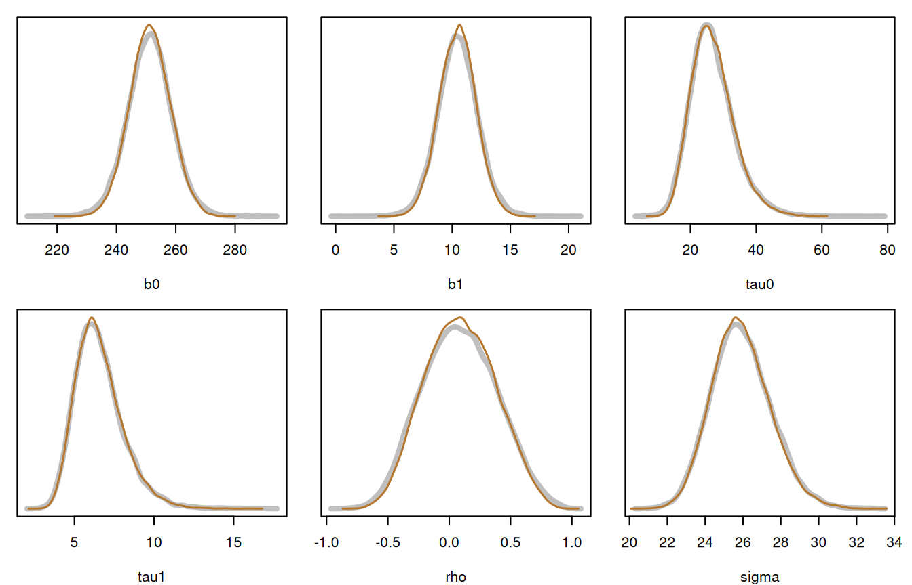
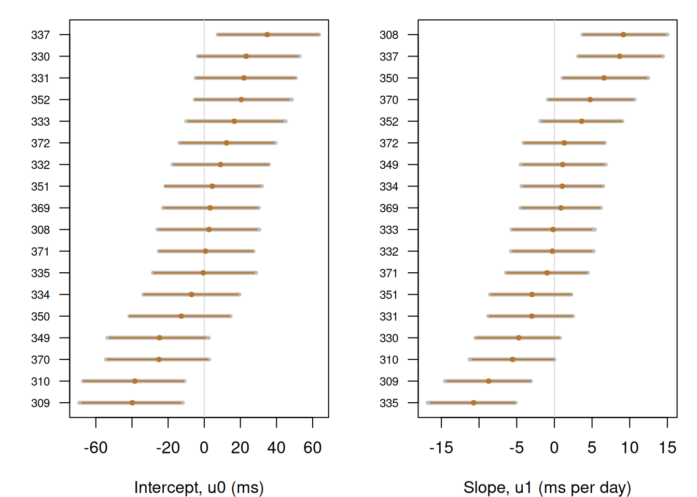
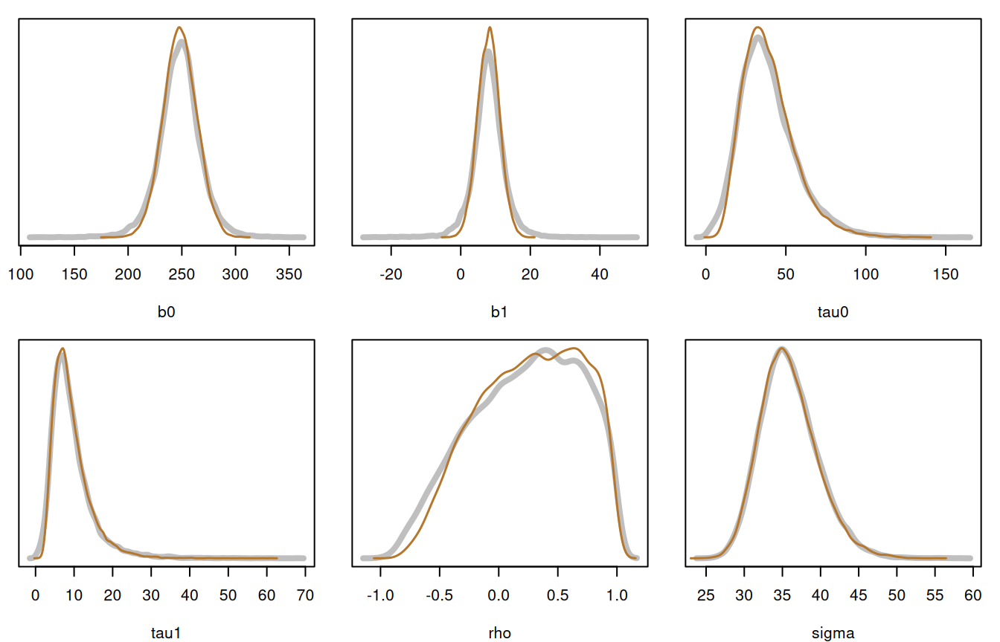

# Multilevel models

[`inla_vanilla()`](http://haziqj.ml/inlavanilla/reference/inla_vanilla.md)
knows nothing about levels or clusters: it sees one log-posterior and a
vector of parameters. A multilevel model fits in that mould when the
random effects are integrated out inside `logpost`, so that the
parameters are only the fixed effects and the variance components. For a
linear mixed model the integral is in closed form.

This article fits a model with correlated random intercepts and slopes,
draws the random effects from the fit afterwards, and compares both with
[brms](https://paulbuerkner.com/brms/) (Bürkner, 2017), which samples
the full model, random effects included, with Stan.

``` r

library(inlavanilla)
data(sleepstudy, package = "lme4")
```

## The model

The `sleepstudy` data (Belenky et al., 2003; Bates et al., 2015) record
the reaction times \\y\_{ij}\\ of 18 subjects over 10 days of sleep
deprivation. Each subject \\j\\ has their own intercept and slope:

\\ y\_{ij} = \beta_0 + u\_{0j} + (\beta_1 + u\_{1j})\\\text{day}\_{ij} +
\epsilon\_{ij}, \qquad \begin{pmatrix} u\_{0j} \\ u\_{1j} \end{pmatrix}
\sim N(0, G), \qquad \epsilon\_{ij} \sim N(0, \sigma^2), \\

where \\G\\ has standard deviations \\\tau_0\\ and \\\tau_1\\ and
correlation \\\rho\\. Integrating out \\u_j\\ leaves, for each subject’s
vector of reaction times,

\\ y_j \sim N\left(X_j \beta,\\ X_j G X_j^\top + \sigma^2 I\right), \\

with \\X_j = \[1, \text{day}\_j\]\\. The priors are \\\beta_0, \beta_1
\sim N(0, 500^2)\\, half-normal \\N(0, 50^2)\\ on \\\tau_0\\, \\\tau_1\\
and \\\sigma\\, and a uniform prior on \\\rho\\.

## The log-posterior

The standard deviations are on the log scale and \\\rho\\ on the atanh
scale, so each prior gets the log-Jacobian of its transform: \\\log
\tau\\ for a standard deviation, and \\\log(1 - \rho^2)\\ for the
correlation.

``` r

logpost <- function(theta, ys, xs) {
  b <- c(theta[["b0"]], theta[["b1"]])
  tau <- exp(c(theta[["log_tau0"]], theta[["log_tau1"]]))
  rho <- tanh(theta[["atanh_rho"]])
  sigma <- exp(theta[["log_sigma"]])
  g <- diag(tau^2)
  g[1, 2] <- g[2, 1] <- rho * tau[1] * tau[2]

  # Marginal log-likelihood, one subject at a time
  loglik <- 0
  for (j in seq_along(ys)) {
    x <- xs[[j]]
    r <- chol(x %*% g %*% t(x) + diag(sigma^2, nrow(x)))
    z <- backsolve(r, ys[[j]] - x %*% b, transpose = TRUE)
    loglik <- loglik - sum(log(diag(r))) - sum(z^2) / 2 -
      nrow(x) / 2 * log(2 * pi)
  }

  # Half-normal prior on a standard deviation, with the log-Jacobian
  lp_sd <- function(s) dnorm(s, 0, 50, log = TRUE) + log(2) + log(s)
  loglik +
    sum(dnorm(b, 0, 500, log = TRUE)) +
    sum(lp_sd(tau)) +
    lp_sd(sigma) +
    log(1 / 2) + log(1 - rho^2)
}
```

The data go in as one response vector and one design matrix per subject:

``` r

by_subject <- split(sleepstudy, sleepstudy$Subject)
ys <- lapply(by_subject, function(d) d$Reaction)
xs <- lapply(by_subject, function(d) cbind(1, d$Days))
```

## The fit

``` r

init <- c(
  b0 = 250, b1 = 10, log_tau0 = log(20), log_tau1 = log(5),
  atanh_rho = 0, log_sigma = log(25)
)
fit <- inla_vanilla(logpost, init, ys = ys, xs = xs)
#> ✔ Found the posterior mode in 20 iterations [75ms]
#> ✔ VB mean correction, max shift 0.3σ [91ms]
#> ✔ Fitted 6 skew-normal marginals [88ms]
fit
#> ── INLAvanilla ───────────────────────────────────────── Skew-normal + VB ──
#> 
#> Log marginal likelihood: -894.67 · Converged in 20 iterations (269ms)
#> 
#>                  Mean      SD      2.5%       50%     97.5%      Mode
#> 1 b0         251.35    6.84    237.93    251.35    264.75    251.36  
#> 2 b1          10.47    1.56      7.41     10.47     13.52     10.47  
#> 3 log_tau0     3.263   0.239     2.787     3.266     3.724     3.271 
#> 4 log_tau1     1.860   0.219     1.444     1.855     2.303     1.845 
#> 5 atanh_rho    0.102   0.313    -0.464     0.084     0.767     0.046 
#> 6 log_sigma    3.2520  0.0593    3.1390    3.2509    3.3715    3.2486
#> 
#> ! 1 check flagged by `summary()`.
```

The marginals are on the unconstrained scale. Draws give the standard
deviations and the correlation on their natural scale:

``` r

natural <- function(theta) {
  c(
    b0 = theta[["b0"]],
    b1 = theta[["b1"]],
    tau0 = exp(theta[["log_tau0"]]),
    tau1 = exp(theta[["log_tau1"]]),
    rho = tanh(theta[["atanh_rho"]]),
    sigma = exp(theta[["log_sigma"]])
  )
}
set.seed(1)
draws <- sampling(fit, nsamp = 20000, fun = natural)
```

## Checking against brms

The same model in brms, with the same priors:

``` r

library(brms)
fit_brms <- brm(
  Reaction ~ 0 + Intercept + Days + (Days | Subject),
  data = sleepstudy,
  prior = c(
    prior(normal(0, 500), class = b),
    prior(normal(0, 50), class = sd),
    prior(normal(0, 50), class = sigma),
    prior(lkj(1), class = cor)
  ),
  chains = 4, iter = 7500, warmup = 2500,
  control = list(adapt_delta = 0.999)
)
```

Its 20,000 draws, with no divergent transitions, were summarised ahead
of time (`lab/multilevel-article.R` in the package source), so this page
does not need Stan to build:

``` r

ref <- readRDS("multilevel-brms.rds")

compare <- function(draws, ref) {
  data.frame(
    brms_mean = ref$summary$mean,
    vanilla_mean = colMeans(draws),
    brms_sd = ref$summary$sd,
    vanilla_sd = apply(draws, 2, sd)
  )
}
round(compare(draws, ref$subjects_18), 3)
#>       brms_mean vanilla_mean brms_sd vanilla_sd
#> b0      251.194      251.311   7.491      6.855
#> b1       10.478       10.471   1.726      1.565
#> tau0     26.791       26.851   6.796      6.493
#> tau1      6.580        6.582   1.542      1.480
#> rho       0.088        0.091   0.300      0.284
#> sigma    25.927       25.905   1.576      1.539
```

The means agree to a small fraction of a standard deviation. The
variance components and \\\rho\\ have about the right spread too. The
fixed effects are about 10% too narrow, for a reason the last section
explains. The densities, brms in grey:

``` r

plot_compare <- function(draws, ref) {
  op <- par(mfrow = c(2, 3), mar = c(4, 1, 1, 1))
  on.exit(par(op))
  for (p in colnames(draws)) {
    d_ref <- ref$density[[p]]
    d_iv <- density(draws[, p], n = 256)
    plot(
      d_ref$x, d_ref$y, type = "l", lwd = 4, col = "grey75",
      ylim = c(0, max(d_ref$y, d_iv$y)), xlab = p, ylab = "", yaxt = "n"
    )
    lines(d_iv, lwd = 1.5, col = "#B5772E")
  }
}
plot_compare(draws, ref$subjects_18)
```



[`inla_vanilla()`](http://haziqj.ml/inlavanilla/reference/inla_vanilla.md)
took a fraction of a second. brms takes seconds to sample, after about a
minute compiling the model.

## The random effects

The fit has no random effects, because `logpost` integrated them out,
but draws bring them back. Given the parameters \\\theta\\, each
subject’s random effects are Gaussian:

\\ u_j \mid y, \theta \sim N(m_j, V_j), \qquad V_j = \left(G^{-1} +
X_j^\top X_j / \sigma^2\right)^{-1}, \qquad m_j = V_j X_j^\top (y_j -
X_j \beta) / \sigma^2. \\

So a draw of \\\theta\\ from the fit, followed by a draw of each \\u_j\\
given \\\theta\\, is a draw from the posterior of the random effects.
[`sampling()`](http://haziqj.ml/inlavanilla/reference/sampling.md)
passes `ys` and `xs` on to `fun`:

``` r

draw_ranef <- function(theta, ys, xs) {
  b <- c(theta[["b0"]], theta[["b1"]])
  tau <- exp(c(theta[["log_tau0"]], theta[["log_tau1"]]))
  rho <- tanh(theta[["atanh_rho"]])
  sigma <- exp(theta[["log_sigma"]])
  g <- diag(tau^2)
  g[1, 2] <- g[2, 1] <- rho * tau[1] * tau[2]
  g_inv <- solve(g)

  # One draw of (u0, u1) for each subject, given theta
  u <- vapply(
    names(ys),
    function(j) {
      x <- xs[[j]]
      v <- solve(g_inv + crossprod(x) / sigma^2)
      m <- v %*% crossprod(x, ys[[j]] - x %*% b) / sigma^2
      drop(m + t(chol(v)) %*% rnorm(2))
    },
    numeric(2)
  )
  c(u0 = u[1, ], u1 = u[2, ])
}
set.seed(1)
u_draws <- sampling(fit, nsamp = 20000, fun = draw_ranef, ys = ys, xs = xs)
```

A caterpillar plot shows each subject’s posterior mean and 95% credible
interval, sorted by the mean, with brms in grey:

``` r

plot_caterpillar <- function(u_draws, ref) {
  op <- par(mfrow = c(1, 2), mar = c(4, 3.5, 1, 1))
  on.exit(par(op))
  xlabs <- c(u0 = "Intercept, u0 (ms)", u1 = "Slope, u1 (ms per day)")
  for (k in names(xlabs)) {
    d <- u_draws[, startsWith(colnames(u_draws), k)]
    est <- cbind(colMeans(d), t(apply(d, 2, quantile, c(0.025, 0.975))))
    est_ref <- as.matrix(ref$ranef[[k]][, c("mean", "2.5%", "97.5%")])
    o <- order(est[, 1])
    y <- seq_along(o)
    plot(
      est[o, 1], y, type = "n", xlim = range(est, est_ref),
      xlab = xlabs[[k]], ylab = "", yaxt = "n"
    )
    axis(2, at = y, labels = rownames(est_ref)[o], las = 1, cex.axis = 0.7)
    abline(v = 0, col = "grey85")
    segments(est_ref[o, 2], y, est_ref[o, 3], y, lwd = 4, col = "grey75")
    segments(est[o, 2], y, est[o, 3], y, lwd = 1.5, col = "#B5772E")
    points(est[o, 1], y, pch = 19, cex = 0.6, col = "#B5772E")
  }
}
plot_caterpillar(u_draws, ref$subjects_18)
```



The means agree with brms to within 1% of the interval’s width, and the
intervals are at most 5% narrower.

## With fewer subjects

With only the first six subjects, the variance components are poorly
determined:

``` r

keep <- 1:6
fit_6 <- inla_vanilla(logpost, init, ys = ys[keep], xs = xs[keep])
#> ✔ Found the posterior mode in 20 iterations [26ms]
#> ✔ VB mean correction, max shift 0.42σ [44ms]
#> ✔ Fitted 6 skew-normal marginals [51ms]
set.seed(1)
draws_6 <- sampling(fit_6, nsamp = 20000, fun = natural)
round(compare(draws_6, ref$subjects_6), 3)
#>       brms_mean vanilla_mean brms_sd vanilla_sd
#> b0      248.014      248.294  19.398     15.581
#> b1        7.963        8.002   4.650      3.115
#> tau0     38.905       39.368  17.676     16.271
#> tau1      9.282        9.273   5.384      4.803
#> rho       0.230        0.262   0.452      0.426
#> sigma    35.939       35.844   3.726      3.716
```

The variance components still match, but the fixed effects are now well
too narrow: the standard deviation of \\\beta_1\\ is a third too small.
Given the variance components, \\\beta\\ is Gaussian, but its marginal
mixes those Gaussians over the uncertain \\\tau_0\\, \\\tau_1\\ and
\\\rho\\, which gives it heavier tails than a skew-normal has.
[`summary()`](https://rdrr.io/r/base/summary.html) flags this as a large
ridge bend:

``` r

summary(fit_6)
#> ── INLAvanilla summary ───────────────────────────────── Skew-normal + VB ──
#> 
#> Log marginal likelihood: -322.764 · Converged in 20 iterations (124ms)
#> Laplace -322.994 + VB term 0.23
#> 937 logpost calls: mode 26ms, VB 44ms, marginals 52ms
#> 
#> ── Posterior marginals ──
#> 
#>                 Mean      SD     2.5%      50%    97.5%     Mode
#> 1 b0         248.4    15.6    217.8    248.4    278.8    248.5  
#> 2 b1           8.00    3.10     1.92     8.00    14.08     8.00 
#> 3 log_tau0     3.592   0.414    2.728    3.610    4.355    3.647
#> 4 log_tau1     2.111   0.477    1.200    2.102    3.070    2.085
#> 5 atanh_rho    0.360   0.595   -0.626    0.293    1.692    0.142
#> 6 log_sigma    3.573   0.102    3.381    3.570    3.783    3.563
#> 
#> ── Diagnostics ──
#> 
#>              VB shift      NMAD  Unscanned  Ridge bend  Mean gap
#> 1 b0           -0.010  0.00028    0.000066    0.63        0.0026
#> 2 b1            0.017  0.000012   0.000063    0.76       -0.019 
#> 3 log_tau0      0.23   0.037      0.00022     0.034       0.073 
#> 4 log_tau1      0.42   0.050      0.0023      0.043       0.13  
#> 5 atanh_rho     0.23   0.041      0.0048      1.1         0.18  
#> 6 log_sigma     0.26   0.0061     0.00043     0.000085   -0.0014
#> 
#> ✔ Mode found in 20 iterations (Newton step 9e-07σ).
#> ✔ Hessian condition number 1.8, in SD units.
#> ✔ VB correction settled in 6 iterations: max shift 0.42σ.
#> ✔ Skew-normal fits: max NMAD 0.050, unscanned mass 0.0048.
#> ! Ridge bend > 0.25 for `atanh_rho` (1.06), `b1` (0.76), `b0` (0.63): the
#>   marginal SD may be >10% too small.
#> ! Mean gap > 0.1σ for `atanh_rho` (0.18), `log_tau1` (0.13): the posterior
#>   is far from Gaussian there, and either mean may be off.
```

``` r

plot_compare(draws_6, ref$subjects_6)
```



The approximation holds up well when the data identify the variance
components, and says so when they do not.

## References

Bates, D., Mächler, M., Bolker, B., & Walker, S. (2015). Fitting linear
mixed-effects models using lme4. *Journal of Statistical Software*,
*67*(1), 1–48. <https://doi.org/10.18637/jss.v067.i01>

Belenky, G., Wesensten, N. J., Thorne, D. R., Thomas, M. L., Sing, H.
C., Redmond, D. P., Russo, M. B., & Balkin, T. J. (2003). Patterns of
performance degradation and restoration during sleep restriction and
subsequent recovery: A sleep dose-response study. *Journal of Sleep
Research*, *12*(1), 1–12.
<https://doi.org/10.1046/j.1365-2869.2003.00337.x>

Bürkner, P.-C. (2017). brms: An R package for Bayesian multilevel models
using Stan. *Journal of Statistical Software*, *80*(1), 1–28.
<https://doi.org/10.18637/jss.v080.i01>
